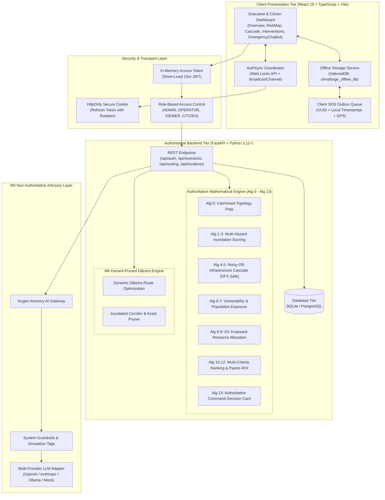

# CLIMAFORGE: Technical Architecture & System Specification
## Final Hackathon Submission Package — Engineering Reference

---

### 1. System Architecture Overview

CLIMAFORGE is built upon a decoupled, security-hardened, and resilient client-server architecture designed for high-availability disaster operations.

---

### 2. Core Components

#### 2.1 Backend Architecture (FastAPI & Python 3.11+)
* **FastAPI Application Framework:** Asynchronous endpoint routing with strict OpenAPI documentation, structured logging, and dependency-injected session management.
* **Pydantic Data Contracts:** Zero untyped dictionaries across core calculation pipelines. Models enforce positive floats, valid ISO timestamps, coordinate bounds, and strict enum values (`CRITICAL`, `HIGH`, `MEDIUM`, `LOW`).
* **Database & Migrations:** SQLAlchemy ORM with declarative models and Alembic versioned migrations (`0001_initial`, `0002_refresh_tokens`, `0003_audit_logs`, `0004_incidents_table`).
* **Security Middleware:** CORS protection, origin whitelisting, Content Security Policy (CSP) headers, rate limiting, and brute-force lockouts.

#### 2.2 Frontend Architecture (React 19, TypeScript, Vite)
* **Single-Page Application (SPA):** Tabbed responsive dashboard (`OverviewTab`, `RiskMapTab`, `CascadeTab`, `InterventionsTab`, `EmergencyChatbotTab`).
* **CSS Custom Properties System:** Responsive dark-mode styling utilizing semantic variables (`var(--bg-primary)`, `var(--accent-red)`, etc.).
* **State Management:** Reactive local state coupled with specialized service singletons (`authSync`, `offlineStorage`, `offlineSync`, `api`).
* **Zero External Heavy Framework Overhead:** Custom high-performance SVG and Canvas rendering for risk maps and cascade trees without multi-megabyte bundle bloat.

---

### 3. Authoritative Algorithms 0–13 Specification

The core calculation pipeline is 100% deterministic, written in pure Python, and completely free of probabilistic language model hallucinations.

| Algorithm | Module | Description & Mathematical Rigor |
| :--- | :--- | :--- |
| **Alg 0** | `alg0_data_prep.py` | Geospatial grid ingestion, catchment polygon boundary validation, elevation normalization. |
| **Alg 1** | `alg1_scoring.py` | Multi-hazard catchment risk scoring: weighted linear combination of rainfall intensity, soil saturation, river stage, and runoff coefficient. Canonical score in test scenarios: 82.4 (`CRITICAL`). |
| **Alg 2** | `alg2_hotspots.py` | Spatial hotspot clustering identifying contiguous sub-catchments exceeding hazard threshold. |
| **Alg 3** | `alg3_zones.py` | Zone-level risk categorization and aggregation across municipal ward polygons. |
| **Alg 4** | `alg4_cascade.py` | Noisy-OR Bayesian probabilistic failure propagation across infrastructure dependency graphs. Depth-First Search (DFS) cycle-detection ensures cyclic asset dependencies (e.g., generator powering pump that cools generator) terminate cleanly without infinite recursions. |
| **Alg 5** | `alg5_node_states.py` | Asset operational status determination (`OPERATIONAL`, `DEGRADED`, `FAILED`) based on cumulative failure probabilities. |
| **Alg 6** | `alg6_vulnerability.py` | Social vulnerability index integration (demographic elderly ratios, mobility constraints, medical dependencies). |
| **Alg 7** | `alg7_exposure.py` | Population and asset exposure calculations combining census blocks with flood polygon intersections. |
| **Alg 8** | `alg8_resource_opt.py` | Dynamic 0/1 Knapsack optimization selecting the optimal combination of flood mitigation interventions (sandbags, mobile barriers, dewatering pumps) under strict municipal budget constraints. |
| **Alg 9** | `alg9_budget.py` | Real-time capital expenditure and operational cost computation for intervention packages. |
| **Alg 10** | `alg10_ranking.py` | Multi-criteria intervention ranking calculating cost-effectiveness, expected population protected, and cascade reduction index. |
| **Alg 11** | `alg11_sensitivity.py` | Sensitivity analysis evaluating intervention stability under ±20% rainfall variance. |
| **Alg 12** | `alg12_pareto.py` | Multi-objective Pareto frontier identification across cost, speed of deployment, and risk reduction. |
| **Alg 13** | `alg13_decision.py` | Command Decision Card synthesis compiling the authoritative operational directive for incident commanders. |

---

### 4. Non-Authoritative Advisory AI Gateway (Nugen / M5)

CLIMAFORGE enforces a strict architectural boundary between authoritative physics and generative AI:

1. **Role Separation:** Nugen never calculates flood depths, never ranks interventions, and never determines safe evacuation corridors. It acts purely as a natural-language explanatory interface for human operators.
2. **Context Injection Guardrails:** The backend compiles authoritative scenario facts (scores, asset statuses, ranked interventions) and injects them as immutable system context.
3. **Hallucination Prevention:** The gateway prompts mandate:
   * *“Answer strictly using the provided authoritative context.”*
   * *“If a metric is absent from the context, state that it is unavailable.”*
   * *“Always append mandatory simulation disclaimers.”*
4. **Resilient Multi-Provider Adapter:** Supports OpenAI (GPT-4o), Anthropic (Claude 3.5 Sonnet), local Ollama (Llama 3), and an automated offline deterministic fallback mode.

---

### 5. Hazard-Pruned Safe Evacuation Routing (M6)

* **Topological Graph:** Modelled as an adjacency network of zones, arterial road segments, and elevated safe refuge centers.
* **Hazard Pruning Logic:**
  * When Alg 1/4 marks a zone as `CRITICAL` or an infrastructure node as `FAILED`, the routing engine queries all intersecting road segments.
  * Inundated road segments receive an infinite travel cost weight ($w = \infty$) or are excised from the active graph.
* **Dijkstra Pathfinding:** Standard shortest-path algorithm is executed over the remaining safe graph.
* **Avoidance Transparency:** The engine explicitly populates `avoided_hazard_nodes` (e.g., `["ZONE-001 (Riverside)", "INFRA-SUB-01 (Riverside Substation)"]`), allowing the frontend to highlight diverted corridors to citizens.
* **Fail-Closed Safety:** If all candidate escape corridors are submerged, the engine returns `status: "BLOCKED"` with explicit instructions: *“Shelter in place on upper floors; do not attempt transit through active flood waters.”* Travel distance and time are explicitly set to `null` to prevent misinterpreting $0.0$ as zero-cost transit.

---

### 6. Offline Panic Storage & Client SOS Outbox (M7)

* **Storage Engine:** IndexedDB (`climaforge_offline_db`) managed via `offlineStorage.ts`.
* **Proactive Caching:** On initial load, the client caches active scenarios, pre-calamity alerts, safe evacuation points, and turn-by-turn guidance.
* **Panic Offline Mode:** If network connectivity drops (`navigator.onLine === false` or API errors), the frontend seamlessly transitions to `cachedData` mode with an ambient amber banner.
* **Client SOS Outbox:**
  * Allows stranded citizens to file emergency reports without internet connectivity.
  * Each record is stamped with a client-generated UUID (`crypto.randomUUID()`), timestamp, zone, urgency level, distress details, and optional GPS coordinates.
  * Status is marked as `NOT_SENT` and immediately rendered in the outbox list.
* **Idempotent Background Synchronization:**
  * A `window.addEventListener('online')` listener triggers automatic background synchronization.
  * The backend (`/api/incidents/batch-sync`) processes reports within a database transaction.
  * If duplicate UUIDs are resubmitted due to network retries, the backend catches unique constraints, rolls back safely, and returns `status: "ACKNOWLEDGED"` with `duplicate_incident_ids`, ensuring exactly-once processing.

---

### 7. Multi-Tab Session Synchronization & Web Locks Security (M16A.7)

* **Threat Model:** Simultaneous token refresh requests across multiple open tabs causing race conditions, refresh token replay detection, and premature session invalidation.
* **Web Locks Coordination:** Tabs request an exclusive lock via `navigator.locks.request('climaforge_auth_refresh_lock')`.
  * The lock-holding tab executes the single network refresh call against `/api/auth/refresh`.
  * Upon receiving the new in-memory access token, it broadcasts a lightweight `REFRESH_COMPLETED` event via `BroadcastChannel('climaforge_auth_channel')`.
  * The broadcast event contains **zero tokens, credentials, or secrets**, prompting peer tabs to silently update their local in-memory expiration timestamps.
* **Fail-Closed Fallback:** If the browser environment lacks Web Locks API support, the platform intentionally refuses to use insecure `localStorage` mutex fallbacks (which suffer from cross-tab race conditions and stale ownership crashes), failing closed safely.

